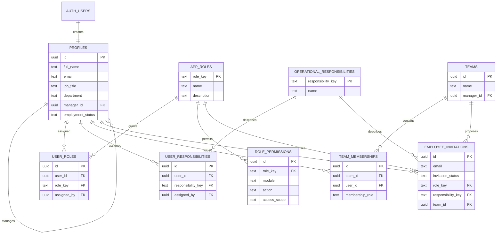

# CareerVeda Placement Operations ERP — Architecture

## Phase 1 scope

Phase 1 establishes login, employee profiles, system roles, separate operational responsibilities, teams, invitations, and permission-aware workspace access. The dashboard must show empty/unconfigured states until real operational records exist; no sample employees, employers, candidates, KPIs, or activity are represented as live data.

## Data model

An Auth lifecycle trigger creates one profile and updates the stored email, but never assigns a role. Profile identity links are the only application-level identity links to the authentication user table; other app records reference profiles.

## System-role templates

| Role | Default access scope | Phase 1 responsibility |
| --- | --- | --- |
| Super Admin | Organization | System access, invitations, assignments, teams, permissions |
| Placement Head | Organization | Organization directory, teams, operational oversight |
| Placement Manager | Team | Team directory and team operations |
| Operations Manager | Team | Team directory and team operations |
| Company Relations Executive | Own | Own profile and assigned company-relations responsibility |
| Candidate Calling Executive | Own | Own profile and assigned candidate-calling responsibility |
| Interview Coordinator | Own | Own profile and assigned interview-coordination responsibility |
| Placement Executive | Own | Own profile and assigned placement responsibility |
| Data & CRM Executive | Own | Own profile and assigned data/CRM responsibility |
| Placement Analyst | Organization | Read-only organization directory, when assigned |
| Viewer | Own | Own profile; no changes to operational data |

Operational responsibilities are separately assigned and may be combined; a responsibility alone never grants access. Role and permission assignments are protected and must be made by an authorized Super Admin.

## Permission design

All access scopes are explicit `own`, `team`, or `organization` grants. A row policy allows access only if the active person's role has the specific resource/action/scope grant, or the record belongs to them. Team scope requires a shared active team; organization scope must be granted explicitly. The database helper functions run with a fixed `search_path` to avoid recursive role-table row policies. Only Super Admin can assign system roles or edit the role-permission catalog. Managers can see or manage only the teams to which they are assigned. Every table is RLS-protected with explicit Data API grants.

### Phase 1 permission matrix

| Action | Super Admin | Placement Head | Placement Manager / Operations Manager | Executive roles | Analyst | Viewer |
| --- | --- | --- | --- | --- | --- | --- |
| See own profile and assigned roles | Own | Own | Own | Own | Own | Own |
| Read employee directory | Organization | Organization | Team | Own | Organization | Own |
| Manage profile identity/status | Organization | — | — | — | — | — |
| Read teams | Organization | Organization | Assigned | Assigned | Organization | Assigned |
| Manage teams | Organization | Organization | Assigned | — | — | — |
| Invite staff / assign system roles | Organization | — | — | — | — | — |
| Edit system role permissions | Organization | — | — | — | — | — |
| Manage operational responsibility assignments | Organization | — | — | — | — | — |

The Phase 1 application surfaces this foundation only; candidate, employer, interview, task, EOD, import/export, and analytics permissions are defined as later feature work rather than represented as functioning modules now.

## Account onboarding

1. The trusted workspace owner supplies/creates the first employee account using Lovable Cloud's invitation-only user administration.
2. No account is assigned Super Admin automatically. A deliberate trusted owner action must create the first Super Admin grant before the in-app invitation and access-management controls unlock.
3. A Super Admin invites subsequent employees and assigns each a system role, one or more responsibilities, and optional team membership.
4. Email confirmation/session behavior remains Cloud-managed. A signed-in employee without a role receives an access-pending screen.
5. Public sign-up is disabled; the app provides sign-in, not self-registration.

## Delivery roadmap

1. ERP foundation — authentication, employees, roles, teams, RLS, permissions.
2. Company and candidate CRM — profiles, company contacts, calling and communication history.
3. Recruitment management — jobs, openings, applications, shortlists and eligibility.
4. Interview and placement — booking, scheduling, feedback, offers and joining.
5. Tasks, assignments and EOD — task execution, role-specific activity totals and review workflow.
6. Excel import and export — validation, safe upserts, custom fields and secure downloads.
7. Dashboards and analytics — live employee, manager, and organization reporting.
8. Automation and production — notifications, scheduled tasks, audit history, security review and rollout.

## Deferred from Phase 1

No company/candidate/job/interview/task/EOD tables, sample records, emails beyond account invitations, WhatsApp integration, file uploads, scheduled jobs, custom exports, or production analytics are included until their phase is approved.